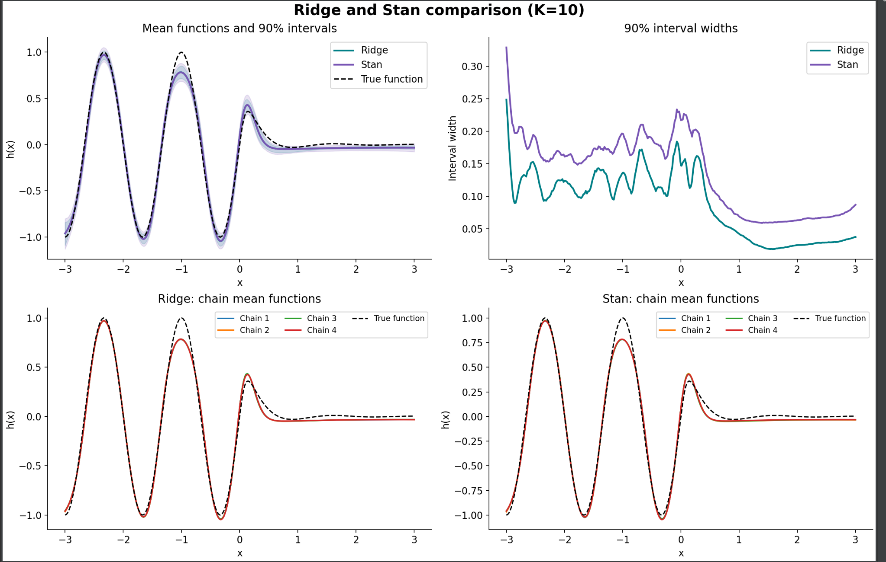

# Posterior Inference in Random Feature Networks

How much can a network's weights vary while its fitted function stays the same? And how much uncertainty disappears when a random readout is replaced by a fitted coefficient vector?

This project studies those questions in one-dimensional Bayesian regression. It starts with random `tanh` features and an analytic ridge readout, develops a sequential Gaussian approximation for the hidden parameters, and compares the resulting function estimates with joint and hierarchical posterior sampling in Stan. The central object of inference is the function: its shape, uncertainty, and stability across posterior draws.

The [experiment report](reports/random-feature-posterior-inference.pdf) records the study. This repository pairs it with readable result tables and a small numerical companion for the fixed-scale calculations.



*Figure 38 from the report. Both constructions use the same hidden-feature draws. Their mean functions nearly coincide, while retaining sampled readout weights produces wider function intervals.*

## 1. Begin with a conditional problem that can be solved exactly

The model is

$$
y_i=h(x_i)+\epsilon_i,\qquad h(x)=\sum_{k=1}^{K}w_k\tanh(a_kx+b_k),\qquad \epsilon_i\sim N(0,\sigma^2).
$$

Conditional on hidden parameters $A,B$, the feature matrix is $F_{ik}=\tanh(a_kx_i+b_k)$. The nonlinear regression becomes a linear Gaussian problem in $w$. With prior covariance $\sigma^2 I/\lambda$, its posterior is

$$
m_w=(F^\top F+\lambda I)^{-1}F^\top y,\qquad V_w=\sigma^2(F^\top F+\lambda I)^{-1}.
$$

This separates two sources of uncertainty: which features should represent the function, and which readout is supported by the observations once those features are fixed. The [numerical implementation](reference/model.py) uses Cholesky solves and retains the conditional covariance alongside the ridge mean. The [method notes](docs/methods.md) specify the prior and penalty convention explicitly.

## 2. Make hidden-parameter inference inexpensive

The simplified TAGI construction approximates the hidden-parameter distribution by independent Gaussians. At each observation, it linearizes `tanh` around the current mean preactivation, propagates uncertainty to the response, and applies a Gaussian conditioning update. For a hidden coordinate $\theta$,

$$
\mu_\theta^+=\mu_\theta+\frac{\mathrm{Cov}(\theta,Y)}{\mathrm{Var}(Y)}(y-\mu_Y),\qquad v_\theta^+=v_\theta-\frac{\mathrm{Cov}(\theta,Y)^2}{\mathrm{Var}(Y)}.
$$

An initial ridge readout is held fixed during this sequential pass. Hidden parameters are then sampled from the approximation, and a new readout is fitted for each feature draw. This gives a computationally simple route from parameter uncertainty to a distribution of fitted curves. The approximation and full update equations appear in [report pages 2–5](reports/random-feature-posterior-inference.pdf#page=2).

The ridge penalty also affects the hidden update: it changes the fixed readout, which enters the parameter–response covariance. Regularization therefore influences both the linear fit and how strongly observations revise the feature distribution.

## 3. Use target shape to examine the feature prior

The synthetic targets include a sine curve, a linear trend with a narrow Gaussian peak, and an asymmetric oscillatory function. They expose different demands on the same feature family.

For one hidden unit,

$$
\frac{d}{dx}\tanh(ax+b)=a\,[1-\tanh^2(ax+b)].
$$

Its maximum absolute slope is $|a|$ when $a\ne0$. This connects the prior scale of $a$ to the ability to represent sharp changes. In the reported fixed-scale experiments, increasing the hidden-parameter prior variances from 0.6 to 3.0 improves the displayed fit of the sharper targets. The derivation provides a reason to investigate that hyperparameter, beyond a blind search for a better curve. See [pages 9–13](reports/random-feature-posterior-inference.pdf#page=9).

The hierarchical extension learns the scales instead. It uses a non-centred parameterization,

$$
a_k=\gamma_a z_{a,k},\quad b_k=\gamma_b z_{b,k},\quad z_{a,k},z_{b,k}\sim N(0,1),
$$

with positive scale hyperpriors and joint NUTS sampling. For the sine target, the bias-scale posterior concentrates near zero, consistent with an odd target being represented by approximately odd hidden features. Comparing half-Cauchy, half-$t_3$, and half-normal hyperpriors then separates sensitivity of the scale parameters from sensitivity of the fitted function ([pages 19–25](reports/random-feature-posterior-inference.pdf#page=19)).

## 4. Evaluate the function despite parameter symmetries

Hidden units can be permuted without changing $h$. Because `tanh` is odd, the transformation

$$
(a_k,b_k,w_k)\longmapsto(-a_k,-b_k,-w_k)
$$

also leaves the output unchanged. Different parameter configurations can therefore encode exactly the same prediction. A weight marginal or a chain-average parameter vector is not, by itself, an adequate summary of function inference.

The study instead evaluates each draw on a common grid. It measures pointwise standard deviation, interval width, pairwise functional RMSE, and agreement between chain-specific curves. It also tracks the global peak, signed integral, and error against the known synthetic truth. These quantities connect posterior diagnostics to questions about the fitted function ([pages 25–35](reports/random-feature-posterior-inference.pdf#page=25)).

## 5. Isolate what the readout contributes

The final comparison holds the sampled hidden features fixed. One construction retains each joint Stan draw of $w$; the other replaces it with a ridge fit. This paired design avoids confounding the comparison with a different collection of features.

For the asymmetric oscillatory target, with `K = 10`, four chains, and 1,000 retained draws:

| Quantity | Ridge readout | Joint Stan readout |
| --- | ---: | ---: |
| Test RMSE against truth, using the fitted mean | 0.0534 | 0.0536 |
| Mean pointwise standard deviation | 0.0275 | 0.0415 |
| Mean pointwise 90% interval width | 0.0884 | 0.1358 |

These measurements are transcribed from Figure 39. They show nearly unchanged mean prediction and appreciably different uncertainty. With matched prior and penalty conventions, the distinction has a precise explanation:

$$
\mathrm{Var}(h_{\ast}\mid D)=\mathbb E[\mathrm{Var}(h_{\ast}\mid A,B,D)\mid D]+\mathrm{Var}(\mathbb E[h_{\ast}\mid A,B,D]\mid D).
$$

Replacing the readout by its conditional mean removes the first term. The companion demonstrates this identity under its explicit model; the [research-design note](docs/research-design.md) distinguishes that calculation from the archived Stan comparison.

For the joint Stan functions, the maximum pointwise R-hat is 1.0070, with minimum bulk/tail ESS of 690/500. The run also records 817 maximum-tree-depth hits, so function agreement is considered alongside sampling efficiency. The [complete experiment notes](docs/experiments.md) retain both diagnostics and metric definitions. The plotted intervals concern latent functions, rather than future noisy observations.

## Run the numerical companion

Use Python 3.10 or later and run from the repository root:

```bash
python -m venv .venv
source .venv/bin/activate
python -m pip install -r requirements.txt
python -m reference.demo --seed 42 --output outputs/demo
python -m unittest discover -s tests -v
```

The [example](reference/demo.py) generates synthetic data, performs the diagonal Gaussian update, and compares ridge-only curves with conditional readout draws. It writes `demo.png` and `metrics.json`. The [five tests](tests/test_reference.py) check the readout equations and covariance, sign/permutation invariance, variance contraction, and the additional uncertainty from sampling the readout.

The companion is separate from the report's original Stan experiments; their executable scripts and chains were not supplied. Recorded measurements remain in the [CSV tables](results/) and report. The [reproduction guide](docs/reproduction.md) explains which outputs each command generates. All data are synthetic; no external account, private dataset, or GPU is required.

## References

James-A. Goulet, Luong Ha Nguyen, and Saeid Amiri. [Tractable Approximate Gaussian Inference for Bayesian Neural Networks](https://www.jmlr.org/papers/v22/20-1009.html). *Journal of Machine Learning Research*, 22(251), 2021.

[Stan Reference Manual: Posterior Analysis](https://mc-stan.org/docs/reference-manual/analysis.html).
